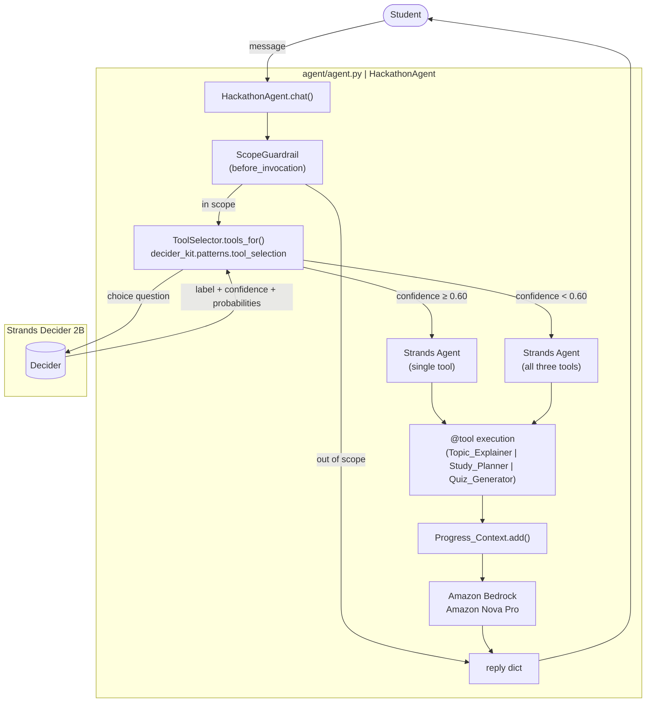

# Design Document: StudyMate AI

## Overview

StudyMate AI is an AI-powered study assistant built on the Strands Agents SDK with Strands
Decider 2B for tool-selection routing. Every incoming student request is classified by the
Decider before the LLM sees it; the Decider's choice narrows the tools available to the
agent, reducing wrong tool calls and keeping prompts lean.

Three `@tool` functions handle the three study domains:

- **Topic_Explainer** — explains a concept in plain language with an example and analogy.
- **Study_Planner** — breaks a syllabus or study goal into a day-by-day task list.
- **Quiz_Generator** — produces practice questions with multiple-choice answers.

Amazon Bedrock (Amazon Nova Pro by default) generates all student-facing natural-language
responses. A `Progress_Context` object accumulates what the student has studied within a
session so the LLM can personalise follow-up responses. A scope guardrail blocks
administrative actions and harmful requests. The agent is deployed on Amazon Bedrock
AgentCore Runtime and is exercised locally through a FastAPI-based web UI.

---

## Architecture



Key design decisions:

1. **Decider as pre-filter, not as LLM replacement.** The Decider classifies the request in
   one fast forward pass; the heavier Nova Pro model only sees the narrowed tool set. This
   keeps LLM latency and cost down while keeping Nova Pro's language quality.

2. **`ToolSelector` is the kit-provided pattern.** `decider_kit.patterns.tool_selection.ToolSelector`
   is used unchanged. The StudyMate-specific work lives in `agent/agent.py` (wiring) and
   `agent/tools.py` (the three `@tool` functions).

3. **`Progress_Context` is in-process session memory.** It is a plain Python object held in
   `HackathonAgent.sessions`. No external database is needed; all data is synthesised
   in-memory, satisfying the "no external writes" safety requirement (Requirement 6.3).

4. **`ScopeGuardrail` uses `DeciderGuardrail` from the kit.** The kit's reusable
   `decider_kit.patterns.guardrails.DeciderGuardrail` is instantiated with a one-sentence
   scope description. The same Decider instance is reused for both tool selection and the
   guardrail, sharing the connection.

5. **Eager mode via environment variable.** `DEMO_EAGER=1` switches the system prompt to one
   that acts without asking, making the decision panel interesting to watch during demos.

---

## Components and Interfaces

### `agent/agent.py` — `HackathonAgent`

```python
class HackathonAgent:
    NAME: str = "StudyMate AI"  # module-level constant

    def __init__(
        self,
        decider: Decider | None = None,
        model_id: str | None = None,
        eager: bool | None = None,
    ): ...

    def chat(
        self,
        message: str,
        session_id: str = "default",
        images: list[Any] | None = None,
    ) -> dict[str, Any]:
        """Returns: {reply, decisions, model_id, latency_ms}"""
```

`HackathonAgent` creates one `Strands Agent` per `session_id`. It holds a dict
`self.sessions: dict[str, tuple[Agent, ProgressContext]]` so the conversation history and
progress context persist across `chat()` calls within a session. A new `session_id` gets a
fresh `ProgressContext` with zero entries.

The method wraps its body in a `try/except` so any unhandled exception returns the safe error
dict instead of surfacing a stack trace to the demo UI.

### `agent/tools.py` — The Three Tool Functions

```python
@tool
def Topic_Explainer(topic: str, difficulty: str = "beginner") -> dict: ...

@tool
def Study_Planner(goal: str, days_available: int = 7) -> list | dict: ...

@tool
def Quiz_Generator(topic: str, count: int = 5) -> dict: ...
```

All three functions are pure, in-memory, and raise no external exceptions. They validate
their inputs themselves and return structured error dicts on invalid input. Each has a
clear one-line docstring because `ToolSelector` uses that line as the choice option label
for the Decider.

### `agent/decision.py` — `ScopeGuardrail`

`ScopeGuardrail` is a thin subclass of `DeciderGuardrail` (from
`decider_kit.patterns.guardrails`) with the scope string set to:

```
"learning support: explaining topics, planning study schedules, and generating practice questions for students"
```

This is passed as `interventions=[ScopeGuardrail(decider)]` to the Strands `Agent`. The
guardrail's `before_invocation` hook checks every incoming message against the scope and
blocks administrative actions and harmful requests before the LLM sees them.

### `decider_kit.patterns.tool_selection.ToolSelector` (kit-provided, used unchanged)

`ToolSelector` is instantiated in `HackathonAgent._session()` with all three tools. Its
`tools_for(request)` method is called once per `chat()` turn to obtain the narrowed
(or full) tool list. The resulting `log` entries are appended to the `decisions` list
returned by `chat()`.

### `demo/server.py` (kit-provided, used unchanged)

The FastAPI server's `/api/chat` endpoint calls `HackathonAgent.chat()` and forwards the
result to the browser. `/api/info` serves the agent name and model metadata for the header.

### `demo/static/index.html` (modified for StudyMate AI)

The existing kit UI is updated with:

- Title and header updated to "StudyMate AI".
- The decision panel highlights entries where `narrowed: true` in a visually distinct style
  (bold tool name with a coloured badge), satisfying Requirement 9.4.

---

## Data Models

### Tool Input/Output Schemas

**Topic_Explainer**

| Direction | Field        | Type   | Constraints                                           |
|-----------|--------------|--------|-------------------------------------------------------|
| Input     | `topic`      | `str`  | 1–500 characters                                      |
| Input     | `difficulty` | `str`  | `"beginner"` \| `"intermediate"` \| `"advanced"`, default `"beginner"` |
| Output (success) | `definition` | `str` | non-empty                                |
| Output (success) | `example`    | `str` | non-empty                                |
| Output (success) | `analogy`    | `str` | vocabulary appropriate to `difficulty`   |
| Output (success) | `difficulty` | `str` | the difficulty actually used             |
| Output (success) | `note`       | `str` | present only when difficulty was unrecognised; states original value and fallback |
| Output (error)   | `error`      | `str` | identifies invalid field and reason      |

**Study_Planner**

| Direction | Field              | Type   | Constraints                           |
|-----------|--------------------|--------|---------------------------------------|
| Input     | `goal`             | `str`  | 1–2000 characters                     |
| Input     | `days_available`   | `int`  | 1–365, default 7                      |
| Output (success) | *(list)*   | `list[dict]` | non-empty                   |
| Output task item | `day`      | `int`  | 1-indexed; every day 1..days_available appears at least once |
| Output task item | `topic`    | `str`  | non-empty                             |
| Output task item | `duration_minutes` | `int` | ≥ 5; sum per day ≤ 180        |
| Output task item | `activity` | `str`  | non-empty                             |
| Output (error)   | `error`    | `str`  | identifies invalid field and reason   |

**Quiz_Generator**

| Direction | Field          | Type        | Constraints                                              |
|-----------|----------------|-------------|----------------------------------------------------------|
| Input     | `topic`        | `str`       | 1–200 characters                                         |
| Input     | `count`        | `int`       | 1–10, default 5; clamped if outside range                |
| Output (success) | *(list)* | `list[dict]` | exactly `count` (or clamped) items               |
| Output question  | `question`    | `str` | non-empty                                        |
| Output question  | `choices`     | `list[str]` | exactly 4 non-empty strings                      |
| Output question  | `correct_answer` | `str`  | exactly matches one element of `choices`         |
| Output question  | `explanation` | `str`  | non-empty                                        |
| Output (clamped) | `note`        | `str`  | states original count and the boundary it was clamped to |
| Output (error)   | `error`       | `str`  | identifies invalid field and reason               |

### `ProgressContext`

```python
@dataclass
class ProgressEntry:
    tool: str          # "Topic_Explainer" | "Study_Planner" | "Quiz_Generator"
    topic_or_goal: str
    timestamp: str     # ISO-8601 UTC, e.g. "2025-07-10T14:32:00Z"

class ProgressContext:
    MAX_ENTRIES: int = 50
    entries: deque[ProgressEntry]  # deque with maxlen=50
```

`ProgressContext.add(entry)` appends to the deque; the `deque(maxlen=50)` discards the
oldest entry automatically when the cap is reached.

`ProgressContext.to_prompt_fragment()` formats all entries as a bulleted list for injection
into the system prompt when there is at least one entry.

### Decision Log Entry

Each entry in the `decisions` list returned by `chat()`:

```python
{
    "tool":         str,          # tool name or "none"
    "confidence":   float | None, # None on Decider exception
    "narrowed":     bool,
    "probabilities": dict[str, float],  # tool name -> probability
    "decider_ms":   int,
}
```

This shape is produced by `ToolSelector.select()` in the kit. `HackathonAgent.chat()`
copies `selector.log` entries (appended since the last call) into the output dict.

---

## Correctness Properties

*A property is a characteristic or behavior that should hold true across all valid
executions of a system — essentially, a formal statement about what the system should do.
Properties serve as the bridge between human-readable specifications and
machine-verifiable correctness guarantees.*

### Property 1: Narrowing collapses the tool set

*For any* confidence value at or above 0.60 returned by a mocked Decider with any valid tool
label, `ToolSelector.tools_for()` shall return a list of exactly one tool whose name matches
the label (or an empty list if the label is `"none"`).

**Validates: Requirements 1.2, 1.5**

---

### Property 2: Below-threshold falls back to the full tool set

*For any* confidence value strictly below 0.60 returned by a mocked Decider, regardless of
the tool label, `ToolSelector.tools_for()` shall return a list containing all three tools
and the corresponding log entry shall have `narrowed=False`.

**Validates: Requirements 1.3**

---

### Property 3: Decision log entry is structurally complete

*For any* call to `ToolSelector.select()`, the resulting entry appended to `selector.log`
shall contain the keys `tool` (str), `confidence` (float or null), `narrowed` (bool),
`probabilities` (dict mapping tool names to floats), and `decider_ms` (int).

**Validates: Requirements 1.4, 7.3**

---

### Property 4: Decider exception triggers safe fallback

*For any* exception raised by the Decider mock during `ToolSelector.tools_for()`, the
method shall return all three tools, and the log entry appended shall have `narrowed=False`
and `confidence=None`.

**Validates: Requirements 1.6**

---

### Property 5: Topic_Explainer returns a well-formed success dict

*For any* non-empty topic string (1–500 characters) and any value from
`{"beginner", "intermediate", "advanced"}`, `Topic_Explainer` shall return a dict containing
the keys `definition`, `example`, `analogy`, and `difficulty`, all of which are non-empty
strings.

**Validates: Requirements 2.2**

---

### Property 6: Whitespace topic is rejected by both topic-bearing tools

*For any* string composed entirely of whitespace characters (including the empty string),
both `Topic_Explainer` and `Quiz_Generator` shall return a dict containing the key `"error"`
whose value identifies `"topic"` as the invalid field.

**Validates: Requirements 2.3, 4.4**

---

### Property 7: Unrecognised difficulty defaults gracefully

*For any* string not in `{"beginner", "intermediate", "advanced"}` passed as the `difficulty`
argument, `Topic_Explainer` shall return a dict with `difficulty="beginner"` and a non-empty
`"note"` key whose value identifies the original value and the fallback used.

**Validates: Requirements 2.4**

---

### Property 8: Study_Planner covers every requested day

*For any* non-empty goal string and any `days_available` value between 1 and 365 inclusive,
`Study_Planner` shall return a non-empty list of task dicts where every integer from 1
through `days_available` appears as the `day` field of at least one dict, and every task
dict contains the keys `day`, `topic`, `duration_minutes`, and `activity`.

**Validates: Requirements 3.2**

---

### Property 9: Daily study load never exceeds 180 minutes

*For any* valid `(goal, days_available)` pair, grouping the result of `Study_Planner` by
`day` and summing `duration_minutes` for each group shall yield a value ≤ 180 for every day.

**Validates: Requirements 3.3**

---

### Property 10: Study_Planner rejects invalid inputs

*For any* string composed entirely of whitespace passed as `goal`, `Study_Planner` shall
return a dict with key `"error"` that identifies `"goal"`. *For any* integer less than 1
passed as `days_available`, `Study_Planner` shall return a dict with key `"error"` that
identifies `"days_available"`. *For any* integer greater than 365 passed as
`days_available`, `Study_Planner` shall likewise return an error dict identifying
`"days_available"`.

**Validates: Requirements 3.4, 3.5, 3.6**

---

### Property 11: Quiz_Generator returns exactly the requested question count with full structure

*For any* non-empty topic string and any `count` in [1, 10], `Quiz_Generator` shall return
a list of exactly `count` dicts; each dict shall contain a non-empty `question` string, a
`choices` list of exactly four non-empty strings, a `correct_answer` string that is exactly
equal to one element of `choices`, and a non-empty `explanation` string.

**Validates: Requirements 4.2**

---

### Property 12: Out-of-range count is clamped with a note

*For any* integer outside [1, 10] passed as `count`, `Quiz_Generator` shall return a result
where the number of question dicts equals `clamp(count, 1, 10)` and the top-level result
dict (or a wrapper dict) includes a `"note"` key stating the original value and the boundary
applied.

**Validates: Requirements 4.3**

---

### Property 13: Progress_Context never exceeds 50 entries and discards oldest first

*For any* sequence of N successful tool invocations where N > 50, the `ProgressContext`
shall contain exactly 50 entries, and those 50 entries shall correspond to the N most recent
invocations (i.e., the oldest N-50 entries are discarded).

**Validates: Requirements 5.1**

---

### Property 14: Successful tool invocation adds a well-formed Progress_Context entry

*For any* successful invocation of any of the three tools within a session, a new entry
shall be appended to `ProgressContext` containing the tool name, a non-empty `topic_or_goal`
string, and a string that satisfies the ISO-8601 UTC datetime format. A failed tool
invocation (one returning an error dict) shall leave `ProgressContext` unchanged.

**Validates: Requirements 5.2**

---

### Property 15: Non-empty Progress_Context is injected into the system prompt

*For any* `ProgressContext` containing at least one entry, the system prompt string passed
to the Strands `Agent` for that session shall contain the tool name, topic/goal, and
timestamp of every entry in the context.

**Validates: Requirements 5.3**

---

### Property 16: New session starts with an empty Progress_Context

*For any* new `session_id` value not previously seen by `HackathonAgent`, the
`ProgressContext` created for that session shall have zero entries before the first message
is processed.

**Validates: Requirements 5.5**

---

### Property 17: chat() always returns the required dict structure

*For any* message string, `HackathonAgent.chat()` shall return a dict that contains exactly
the keys `reply` (str), `decisions` (list), `model_id` (str), and `latency_ms` (int ≥ 0),
whether the request succeeds or raises an internal exception.

**Validates: Requirements 7.2, 7.6**

---

### Redundancy Check and Consolidation Notes

After the initial analysis, the following consolidations were applied:

- **Properties 6** combines the whitespace-topic error case from Requirements 2.3 and 4.4
  because both tools share the same input validation rule; testing them together with one
  property generator is more efficient than two identical-structure properties.
- **Property 10** combines Requirements 3.4, 3.5, and 3.6 because all three are
  input-validation error cases for the same tool with the same error dict shape; the
  generator simply varies the invalid input type.
- **Property 3** covers both Requirement 1.4 and 7.3 because they describe the same
  structural invariant from two different requirement sections.
- **Property 17** covers both the happy-path (7.2) and exception-path (7.6) struct invariant
  because both require the same keys; a single generator that includes an exception injection
  scenario validates both at once.

---

## Error Handling

### Tool Input Validation

All three tools use the same validation approach: check inputs synchronously at the top of
the function and return a structured `{"error": "<field>: <reason>"}` dict rather than
raising. This keeps the Strands `Agent` loop running normally — the LLM sees the error dict
as a tool result and can tell the student.

```
Topic_Explainer:
  - empty/whitespace topic   → {"error": "topic: empty or whitespace-only"}
  - bad difficulty           → proceed with {"difficulty": "beginner", "note": "..."}

Study_Planner:
  - empty/whitespace goal    → {"error": "goal: empty or whitespace-only"}
  - days_available < 1       → {"error": "days_available: less than minimum of 1"}
  - days_available > 365     → {"error": "days_available: exceeds maximum of 365"}

Quiz_Generator:
  - empty/whitespace topic   → {"error": "topic: empty or whitespace-only"}
  - count outside [1,10]     → proceed with clamped count + {"note": "..."}
```

### Decider Errors

`ToolSelector.select()` wraps the `Decider.ask()` call in a `try/except`. On any exception
(network failure, timeout, `DeciderError`):
- Returns a `Selection` with `confidence=None` and `narrowed=False`.
- Logs `{"tool": "fallback", "confidence": None, "narrowed": False, ...}` in the decision log.
- Exposes all three tools to the LLM (safe fallback).
- Does not surface the internal error to the student.

### HackathonAgent Exception Boundary

`HackathonAgent.chat()` wraps its entire body in `try/except Exception`. On any unhandled
exception it returns:

```python
{
    "reply": "I'm sorry, something went wrong. Please try again.",
    "decisions": [],
    "model_id": self.model_id,
    "latency_ms": <elapsed>,
}
```

### Scope Guardrail Rejections

`ScopeGuardrail.before_invocation()` returning `Guide` or `Deny` causes the Strands Agent
to either re-prompt itself or surface a refusal. No tool is called; the agent's reply comes
from the LLM guided by the feedback string. The guardrail logs each decision in the decisions
list so the demo panel shows it.

---

## Testing Strategy

### Dual Testing Approach

Unit tests cover specific examples and edge cases. Property tests verify universal invariants
across hundreds of generated inputs. Both are needed: unit tests catch concrete regressions;
property tests catch the classes of edge cases that humans fail to enumerate.

### Property-Based Testing Library

**`hypothesis`** is chosen as the property-based testing library for Python.
Each property test is decorated with `@given(...)` and configured with
`@settings(max_examples=100)`. Every test has a comment referencing its design property:

```
# Feature: studymate-ai, Property N: <property text>
```

### Unit Tests (`tests/test_tools.py`, `tests/test_agent.py`)

Specific examples for:
- `Topic_Explainer` happy path with each difficulty level.
- `Study_Planner` with `days_available=1`, `days_available=365`.
- `Quiz_Generator` with `count=1`, `count=10`.
- `HackathonAgent(eager=True)` and `HackathonAgent(eager=False)` constructors.
- `NAME` constant is a non-empty string.
- `agent/eval_cases.jsonl` has ≥ 15 entries, all required keys, correct split counts.

### Property Tests (`tests/test_properties.py`)

One property-based test per property in the design:

| Test | Hypothesis Strategy | Design Property |
|------|---------------------|-----------------|
| `test_narrowing_collapses` | `confidence ∈ [0.60, 1.0]`, tool label from valid set | Property 1 |
| `test_below_threshold_fallback` | `confidence ∈ [0.0, 0.60)` | Property 2 |
| `test_decision_log_shape` | any confidence, any label | Property 3 |
| `test_decider_exception_fallback` | any `Exception` subclass | Property 4 |
| `test_explainer_success_shape` | `topic ∈ st.text(1..500)`, `difficulty ∈ valid set` | Property 5 |
| `test_whitespace_topic_rejected` | `topic ∈ st.text(whitespace)` | Property 6 |
| `test_bad_difficulty_defaults` | `difficulty ∈ st.text() - valid set` | Property 7 |
| `test_planner_covers_all_days` | `goal ∈ st.text(1..2000)`, `days ∈ st.integers(1..365)` | Property 8 |
| `test_planner_daily_cap` | same as above | Property 9 |
| `test_planner_rejects_invalid` | whitespace goals, integers outside [1..365] | Property 10 |
| `test_quiz_count_and_structure` | `topic ∈ st.text(1..200)`, `count ∈ st.integers(1..10)` | Property 11 |
| `test_quiz_clamp_and_note` | `count ∈ st.integers() - [1..10]` | Property 12 |
| `test_progress_context_cap` | `n ∈ st.integers(51..200)` successful tool events | Property 13 |
| `test_progress_context_add_entry` | random tool names, topics | Property 14 |
| `test_progress_context_in_prompt` | non-empty context objects | Property 15 |
| `test_new_session_empty_context` | random session_id strings | Property 16 |
| `test_chat_return_shape` | any message, including exception-injected scenarios | Property 17 |

### Evaluation Benchmark (`agent/eval_cases.jsonl`)

`decider_kit.bench` is used to run the benchmark:

```bash
./kit bench
```

The file contains ≥ 15 cases:
- ≥ 3 with expected label `"explain_topic"`
- ≥ 3 with expected label `"create_study_plan"`
- ≥ 3 with expected label `"generate_quiz"`
- ≥ 3 with expected label `"none"`
- ≥ 5 cases with `split: "tune"`
- ≥ 10 cases with `split: "test"` (or omitted)

### Integration Tests

Smoke tests (run against a live Decider and Bedrock endpoint) verify:
- `ToolSelector` calls the Decider with the correct question format for one sample message.
- A full `HackathonAgent.chat()` round-trip with each tool returns a valid dict.

These are tagged `@pytest.mark.integration` and excluded from CI by default.

### Deployment Verification

After `./kit deploy`:
- AgentCore Runtime ARN is captured in `submission/deployment.json`.
- The demo server is re-pointed to AgentCore (`DEMO_TARGET=agentcore`) and at least one
  `chat()` call is made to verify the deployed agent returns a valid response.
